# SiC MOSFET double-pulse test in simulation (onsemi EliteSiC M3S)

Switching characterisation of a 1200 V silicon-carbide MOSFET in a simulated double-pulse
test (DPT), using the manufacturer's own SPICE model, validated against the datasheet and
turned into design numbers: gate-resistor choice, stray-inductance budget, Kelvin-source
benefit and false-turn-on margin. Everything is reproducible with one command.

> This is a simulation study with vendor physical/behavioural models; it has not been
> compared with hardware measurements. Independent project, not affiliated with or
> endorsed by onsemi.

## 1. Problem

A DPT is the standard way to measure turn-on/turn-off energy (Eon, Eoff), the
free-wheeling diode's recovery (Err), dv/dt, di/dt and voltage overshoot of a power
switch under realistic inductive switching. Before a board exists, the same test can be run
in SPICE to answer design questions:

* Which turn-on / turn-off gate resistors keep dv/dt and voltage overshoot within limits at
  the lowest loss?
* How much power-loop inductance can the layout afford?
* What does the Kelvin-source pin of a TO-247-4L package actually save?
* Is the off-state device at risk of false (Miller) turn-on?

The answers are only as good as the model, so the model is checked and validated first.

## 2. Set-up

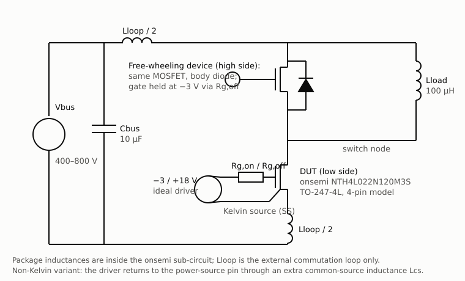

| Item | Choice | Why |
|---|---|---|
| DUT | onsemi **NTH4L022N120M3S** (1200 V, 22 mΩ, M3S, TO-247-4L) | Mainstream 800 V-bus part; datasheet gives Eon/Eoff at 800 V / 40 A with the body diode free-wheeling |
| Model | onsemi physical scalable LTspice model, 4-pin isothermal variant (library v2.3) | Manufacturer model; follows `.temp` |
| Free-wheeling device | Same part, body diode, gate held at the off-voltage through Rg,off | Matches the datasheet test ("EON/EOFF result is with body diode") |
| Gate drive | −3 / +18 V ideal source, 5 ns edges, separate Rg,on / Rg,off | Datasheet conditions |
| Strays | External power loop `Lloop` (split above/below the half-bridge); package inductances inside the model; optional extra common-source inductance `Lcs` | One knob per physical effect |
| Load | 100 µH, first pulse sized so the switched current equals the target | Currents are measured, not assumed |
| Simulator | LTspice 26.0.1, batch mode, Alternate solver | The onsemi models exist only vendor-encrypted (LTspice / PSpice); ngspice cannot run them |
| Nominal point | 800 V, 40 A, Rg = 4.5 Ω, 30 nH, 25 °C, Kelvin drive | Datasheet condition plus a typical TO-247 DPT loop |

The 650 V sister part NTH4L032N065M3S was also selected (its datasheet adds a 175 °C
point), but its model fails the dynamic sanity check in this simulator; it is reported,
not used. Integration windows and all other definitions are in [DESIGN.md](DESIGN.md) §7.

## 3. Method

1. **Model sanity checks** (`dpt.model_checks`): static RDS(on) at 25 and 175 °C and a
   resistive-load turn-on, before any switching study.
2. **Convergence-aid check**: results are shown to be independent of LTspice's `cshunt`
   (they were not at the commonly used 1 fF; DESIGN.md §6).
3. **Validation**: the datasheet Eon/Eoff condition, simulated over a loop-inductance
   bracket because the datasheet does not publish its test-board inductance.
4. **Sweeps**: Rg,on, Rg,off, loop inductance, bus voltage, load current, temperature,
   off-state gate voltage, Kelvin vs non-Kelvin with extra common-source inductance.
5. **Extraction** (`dpt.extract`, unit-tested on synthetic waveforms with analytic
   answers): Eon, Eoff, Err, dv/dt (20-80 % average and 1 ns peak), di/dt, overshoot,
   ringing frequency and damping, gate bounce, switching times.

## 4. Results

Everything between the two markers below is written by `python -m dpt.run_all` from
`results/summary.json`; no number in it is typed by hand.

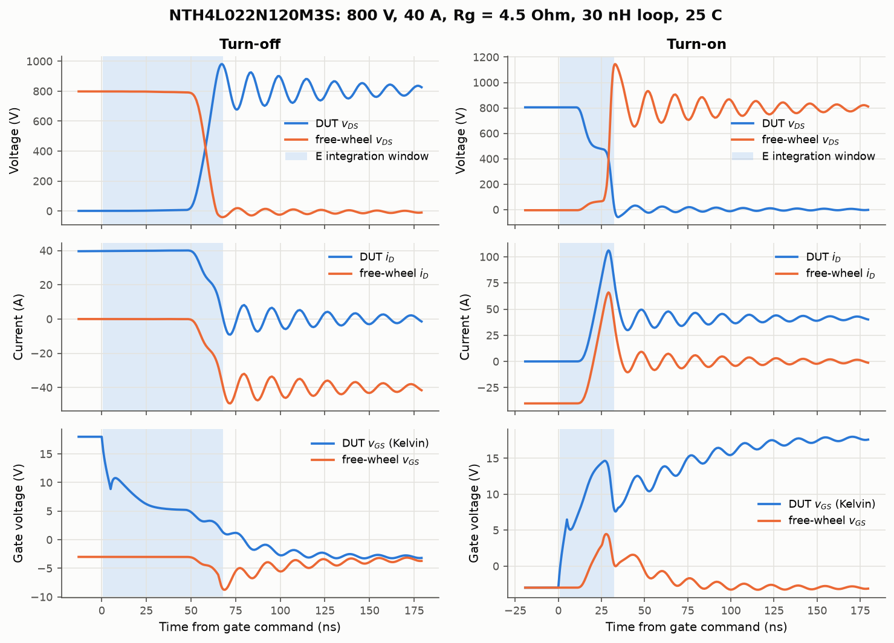

<!-- RESULTS:START (generated by python -m dpt.run_all; do not edit) -->

#### Key findings

- **Validation (NTH4L022N120M3S, 800 V / 40 A / 4.5 Ω):** at a 30 nH loop the simulated Eon is -8 % and Eoff -25 % from the datasheet typicals (Etot -14 %). Over a 10-50 nH bracket (the datasheet does not publish its loop inductance) Eon spans -33 … +16 % and Eoff -34 … -19 %.
- **Why Eoff is low:** Eoff rises steeply with turn-off gate resistance; the sweep reproduces the datasheet Eoff at Rg,off ≈ 6.3 Ω, i.e. about 1.8 Ω more than the datasheet's external 4.5 Ω. An ideal 0 Ω driver with no gate-loop impedance is the fastest possible case, so a lower simulated Eoff is expected (driver output resistance is typically 0.5–2 Ω).
- **Convergence aid matters:** with LTspice's `cshunt` at 1e-15 F the modelled Eon is 6.0× the converged value; results only become independent of it at ≤ 1e-19 F (DESIGN.md §6).
- **Gate resistors (1 ns peak dv/dt ≤ 50 V/ns, every vDS peak ≤ 960 V):** the lowest-loss swept Rg,off meeting both is 15 Ω (Eoff 494 µJ, 3.0× the 4.5 Ω value); Rg,on ≥ 10 Ω keeps the free-wheel recovery peak in limits, but no swept Rg,on meets the dv/dt limit (lowest peak 70 V/ns at 22 Ω): the final vDS collapse is set by the body-diode recovery rather than by the gate.
- **Stray budget:** the external power loop must stay below ≈ 16 nH at 800 V / 40 A / 4.5 Ω to keep both the DUT turn-off peak and the free-wheel recovery peak under 960 V.
- **Kelvin source:** returning the driver to the power-source pin instead of the Kelvin pin raises Eon + Eoff by 48 % from the package inductance alone; with 10 nH of extra shared inductance the gate loop oscillates beyond the gate rating.
- **False turn-on check:** at the nominal point the free-wheeling device's gate peaks at 4.5 V during DUT turn-on, above VGS(th),min = 2.04 V despite the −3 V off-bias (see the Rg,on table).
- **Off-state bias:** -5 V restores a +0.76 V margin against false turn-on (and lowers Err to 219 µJ), but the free-wheel gate then swings to -10.56 V at DUT turn-off, below the −10 V absolute rating; a Miller clamp or a less negative bias with a stronger hold-off path is needed.

#### Model sanity checks (run before any switching study)

| Part | RDS(on) 25 °C sim / ds | RDS(on) 175 °C sim / ds | Resistive turn-on delay | Used |
|---|---|---|---|---|
| NTH4L022N120M3S | 21.5 / 22 mΩ | 43.0 / 44 mΩ | 19 ns | yes |
| NTH4L032N065M3S | 33.9 / 32 mΩ | 49.5 / 49 mΩ | 605 ns | no (> 100 ns) |

#### Validation against the datasheet (Kelvin drive, body-diode free-wheeling)

| Part | Condition | Loop L | Eon sim / ds (µJ) | dev. | Eoff sim / ds (µJ) | dev. | Etot dev. |
|---|---|---|---|---|---|---|---|
| NTH4L022N120M3S | 800 V, 40 A, 4.5 Ω, 25 °C | 10 nH | 566 / 490 | 16 % | 147 / 221 | -34 % | 0 % |
| NTH4L022N120M3S | 800 V, 40 A, 4.5 Ω, 25 °C | 20 nH | 511 / 490 | 4 % | 157 / 221 | -29 % | -6 % |
| NTH4L022N120M3S | 800 V, 40 A, 4.5 Ω, 25 °C | 30 nH | 449 / 490 | -8 % | 166 / 221 | -25 % | -14 % |
| NTH4L022N120M3S | 800 V, 40 A, 4.5 Ω, 25 °C | 50 nH | 326 / 490 | -33 % | 179 / 221 | -19 % | -29 % |

Switching times at the nominal point (30 nH). The datasheet does not define its time
thresholds, so both the current-based and the voltage-based definitions are listed:

| Time | Datasheet | Sim, current-based | Sim, voltage-based |
|---|---|---|---|
| td(on) | 18 ns | 13.7 ns | 13.3 ns |
| tr | 24 ns | 5.4 ns | 17.8 ns |
| td(off) | 48 ns | 52.4 ns | 51.4 ns |
| tf | 13 ns | 14.1 ns | 9.9 ns |

#### Nominal operating point (800 V, 40 A, Rg = 4.5 Ω, 30 nH, 25 °C)

| Quantity | Value |
|---|---|
| Switched current at turn-off / turn-on | 40.1 A / 40.1 A |
| Eon / Eoff / Err | 449 / 166 / 268 µJ |
| Turn-off dv/dt (20-80 % avg / 1 ns peak), di/dt | 67 / 79 V/ns, -2.10 A/ns |
| Turn-on dv/dt (20-80 % avg / 1 ns peak), di/dt | -31 / 131 V/ns, 6.35 A/ns |
| DUT turn-off peak vDS | 981 V (+181 V) |
| Free-wheel peak vDS at DUT turn-on | 1145 V |
| Turn-off ringing | 64 MHz, ζ = 0.036 |
| Free-wheel gate excursion (max / min vGS) | 4.47 V / -8.75 V (VGS(th) min = 2.04 V) |
| Reverse recovery Irrm, Qrr (incl. Coss charge) | 66 A, 568 nC |

#### Gate-resistor choice (limits: |dv/dt| ≤ 50 V/ns, every vDS peak ≤ 960 V)

| Rg,on (Ω) | Eon (µJ) | Err (µJ) | turn-on dv/dt avg / max (V/ns) | free-wheel peak vDS (V) | free-wheel vGS max (V) |
|---|---|---|---|---|---|
| 1 | 165 | 556 | 47 / 158 | 1441 | 7.24 |
| 2.2 | 297 | 407 | 38 / 142 | 1301 | 5.78 |
| 4.5 | 449 | 268 | 31 / 131 | 1145 | 4.47 |
| 10 | 657 | 134 | 31 / 104 | 931 | 3.27 |
| 15 | 801 | 85 | 57 / 87 | 870 | 2.73 |
| 22 | 986 | 54 | 49 / 70 | 837 | 2.21 |

| Rg,off (Ω) | Eoff (µJ) | turn-off dv/dt avg / max (V/ns) | DUT peak vDS (V) | free-wheel vGS min (V) |
|---|---|---|---|---|
| 1 | 68 | 110 / 122 | 868 | -4.89 |
| 2.2 | 101 | 87 / 92 | 952 | -6.83 |
| 4.5 | 166 | 67 / 79 | 981 | -8.75 |
| 10 | 331 | 46 / 52 | 928 | -9.67 |
| 15 | 494 | 34 / 38 | 905 | -9.81 |
| 22 | 738 | 25 / 28 | 884 | -9.80 |

Lowest-loss swept values meeting both limits: Rg,on: none, Rg,off = 15.0 Ω (dv/dt limit applied to the 1 ns peak).

#### False turn-on margin vs off-state gate voltage (both devices, 800 V / 40 A)

| Off-state vGS (V) | Free-wheel vGS peak (V) | Margin to VGS(th),min = 2.04 V | Free-wheel vGS min (V) | Eon (µJ) | Err (µJ) | Eoff (µJ) |
|---|---|---|---|---|---|---|
| 0 | 8.34 | -6.30 V | -5.85 | 623 | 746 | 249 |
| -3 | 4.47 | -2.43 V | -8.75 | 449 | 268 | 166 |
| -5 | 1.28 | +0.76 V | -10.56 | 440 | 219 | 134 |

#### Stray-inductance budget (800 V, 40 A, Rg = 4.5 Ω)

| External loop L (nH) | DUT turn-off peak vDS (V) | Free-wheel peak vDS at turn-on (V) | Ringing (MHz) |
|---|---|---|---|
| 5 | 867 | 829 | n/a |
| 10 | 890 | 877 | 87 |
| 20 | 940 | 1013 | 73 |
| 30 | 981 | 1145 | 64 |
| 50 | 1036 | 1322 | 53 |
| 80 | 1095 | 1492 | 44 |

Largest external loop inductance keeping both peaks ≤ 960 V: **15.7 nH** (turn-off alone: 25.0 nH; free-wheel recovery alone: 16.1 nH; linear interpolation between swept points).

#### Kelvin-source benefit (800 V, 40 A, Rg = 4.5 Ω, 30 nH)

Kelvin drive: Eon + Eoff = 614 µJ.

| Non-Kelvin: extra common-source L (nH) | Eon (µJ) | Eoff (µJ) | Eon + Eoff (µJ) | vs Kelvin | DUT vGS range (V) |
|---|---|---|---|---|---|
| 0 | 701 | 209 | 910 | +48 % | -3 … 18 |
| 2 | 902 | 294 | 1195 | +95 % | -3 … 18 |
| 5 | 1164 | 433 | 1597 | +160 % | -3 … 18 |
| 10 | – | – | – | – | **-45 … 84: gate loop oscillates** |

0 nH = driver returned to the power-source pin, so only the package source
inductance is shared between the gate and power loops.

#### Convergence-aid check (nominal point)

| cshunt (F) | Eon (µJ) | tr (ns) | Eoff (µJ) |
|---|---|---|---|
| 1e-15 | 2713 | 81.0 | 163 |
| 1e-16 | 1235 | 27.7 | 163 |
| 1e-17 | 731 | 11.6 | 164 |
| 1e-19 | 454 | 5.8 | 164 |
| 1e-21 | 449 | 5.4 | 166 |
| 1e-22 | 448 | 5.4 | 166 |

Sweep runs that failed on every cshunt retry: 0.

<!-- RESULTS:END -->

### Figures

| | |
|---|---|
| 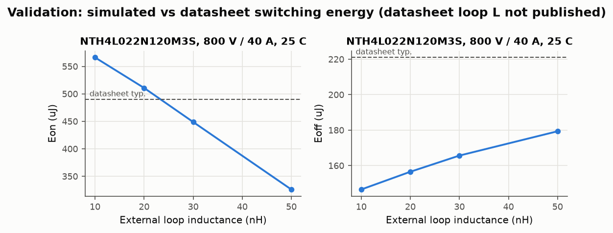 | 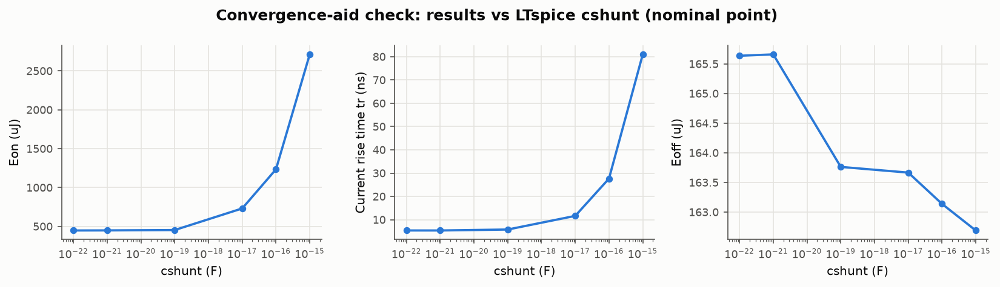 |
| 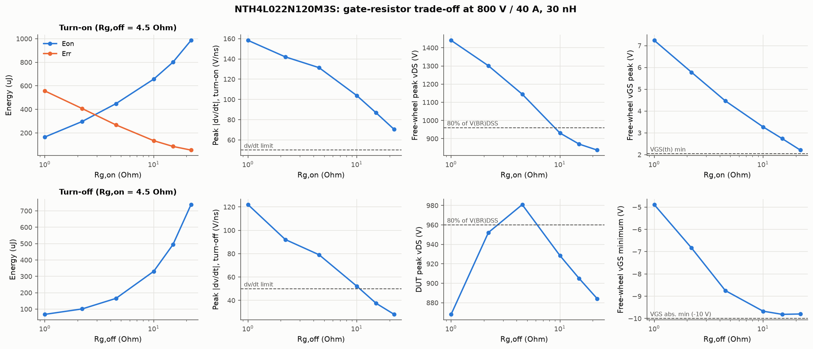 | 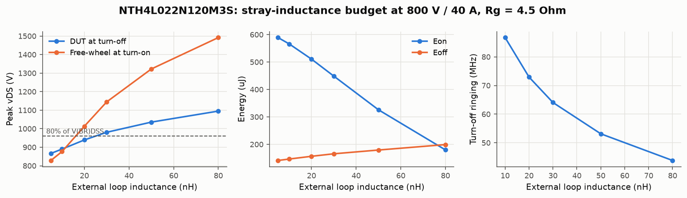 |
| 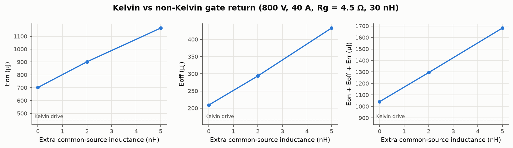 | 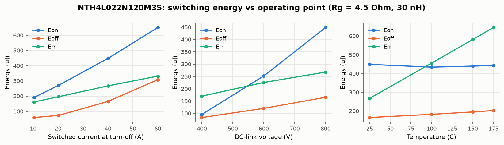 |

### Screenshots

Console runs, captured as text from the real commands
(`docs/screenshots/transcripts/`) and rendered with `scripts/render_console.py`;
browser views of this report rendered with `scripts/readme_to_html.py`.

| | |
|---|---|
| 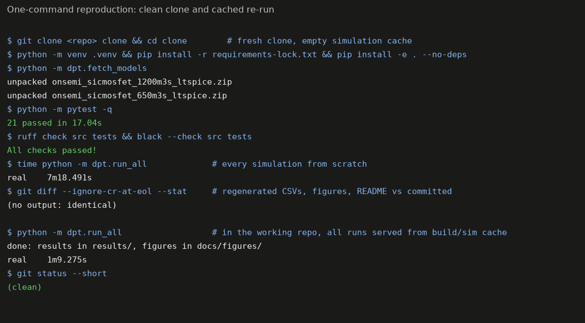 | 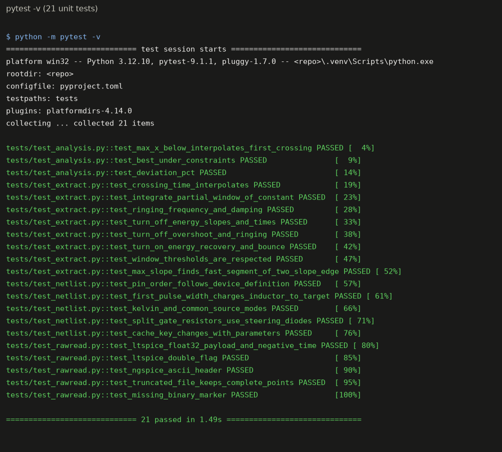 |
| 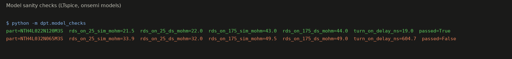 | 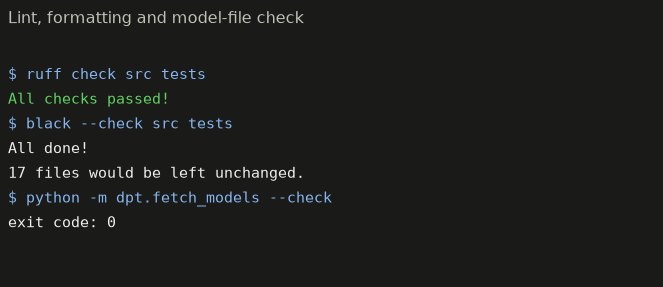 |
| 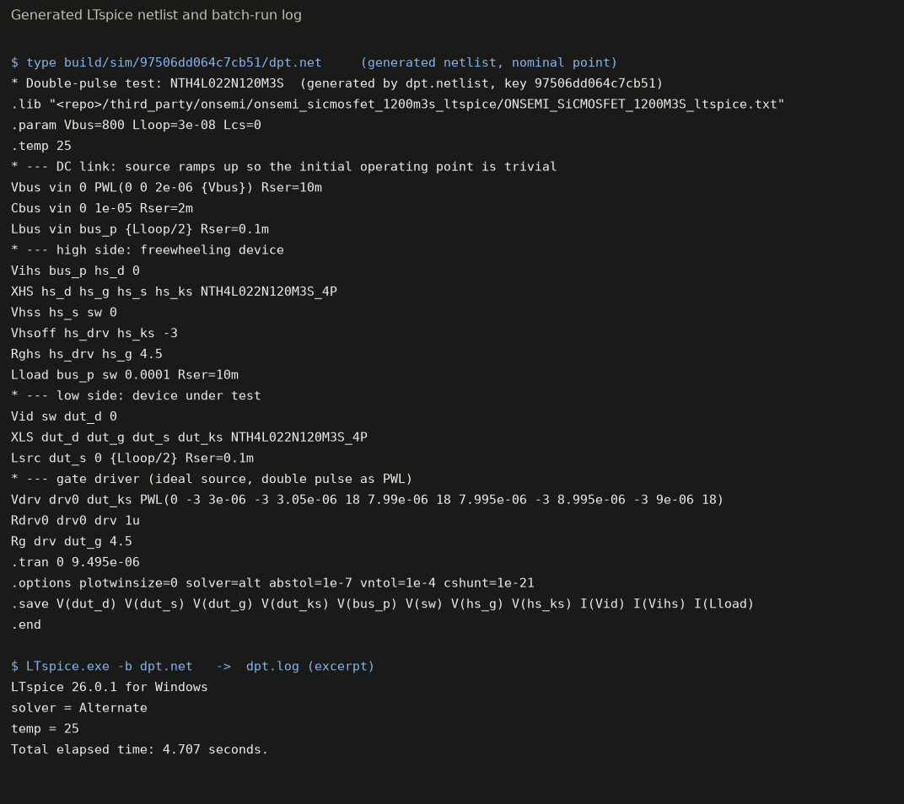 | 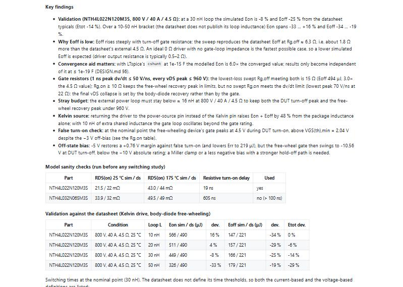 |

## 5. Engineering decisions and trade-offs

* **Rg,on and Rg,off are separate design variables.** Rg,on mostly trades Eon against the
  free-wheeling device's recovery overshoot and gate bounce; Rg,off trades Eoff against
  turn-off dv/dt and the DUT overshoot. A split driver (separate source/sink outputs)
  lets each be set to its own limit instead of compromising on one value.
* **Turn-on dv/dt is not fixed by Rg,on alone.** The last part of the vDS fall is set by
  the body-diode recovery, so the peak dv/dt stays high even at large Rg,on. If an EMI
  limit applies to the peak slope, the lever is the free-wheeling device (Schottky or
  softer-recovery part) or an RC snubber, not more gate resistance.
* **Very low Rg,off gives *less* overshoot.** At 1-2 Ω the channel turns off before the
  voltage rises and the turn-off becomes capacitive (the load current charges Coss), so
  the DUT peak falls again, at the price of turn-off dv/dt far above common EMI limits.
* **Layout budget.** The free-wheeling device's recovery overshoot, not the DUT turn-off
  overshoot, sets the loop-inductance limit. A review that only checks the DUT turn-off
  spike would accept a loop that overstresses the high-side device.
* **Kelvin source.** Use it. Returning the driver to the power pin puts the package source
  inductance into the gate loop; extra shared PCB inductance first costs energy and then
  makes the gate loop oscillate.
* **Off-state gate voltage.** −3 V does not keep the free-wheeling device below its
  minimum threshold during a fast DUT turn-on; −5 V does, but its negative excursion at
  the other edge then violates the −10 V rating. An active Miller clamp is the standard
  fix and the next thing to simulate.

## 6. Limitations

* **Simulation only**, no hardware measurement. The validation compares with datasheet
  *typical* values measured on a board whose loop inductance, probe bandwidth and deskew
  are not published.
* **Ideal gate driver** (no output resistance, gate-loop inductance or propagation delay).
  This is the main reason the simulated Eoff is below the datasheet (see Key findings).
* **Vendor model, encrypted.** Its internals cannot be inspected; accuracy outside the
  characterised range (e.g. vDS above V(BR)DSS during large-loop recovery overshoots) is
  unknown, and avalanche behaviour is not assessed here.
* **Isothermal.** The 4-pin model has self-heating disabled; temperature is a parameter.
  The 6-pin thermal variant would not run with the Alternate solver (singular matrix).
* **Terminal measurement.** As in a real DPT, the DUT's own Coss energy at turn-on is not
  visible at the terminals; Err/Qrr include the free-wheeler's Coss charge and are not
  comparable with the datasheet Qrr (measured at 1 A/ns).
* **One simulator.** Results depend on LTspice's convergence aid until it is small enough;
  the study shows where the plateau is, but no second simulator could cross-check because
  the models only exist encrypted for LTspice and PSpice.
* **650 V part excluded**: its model shows a non-physical ~600 ns turn-on delay in
  LTspice 26.0.1 (open item, DESIGN.md §5).

## 7. How to reproduce

Requirements: Windows or macOS with [LTspice](https://www.analog.com/ltspice) (tested with
26.0.1) and Python ≥ 3.11.

```bash
python -m venv .venv
.venv/Scripts/activate                  # macOS: source .venv/bin/activate
pip install -r requirements-lock.txt
pip install -e . --no-deps
python -m dpt.fetch_models              # says which two onsemi ZIPs to download and where
python -m pytest -q                     # unit tests (no simulator needed)
python -m dpt.run_all                   # all simulations (~10 min), CSVs, figures, README tables
```

`make all` runs the same steps where `make` is available. Every simulation is cached in
`build/sim/<config-hash>/` with its netlist, log and raw file, so any run can be opened in
LTspice by hand. Set `LTSPICE_EXE` if LTspice is not in its default location.

### Repository layout

```
src/dpt/
  netlist.py        DPT netlist generator (LTspice dialect), all circuit parameters
  ltspice.py        batch runner, cache, convergence retry ladder
  rawread.py        binary .raw reader (LTspice + ngspice dialects)
  extract.py        Eon/Eoff/Err, dv/dt, di/dt, overshoot, ringing, gate bounce, times
  model_checks.py   RDS(on) and turn-on-delay sanity checks per model
  devices.py        parts, pin orders, datasheet reference values (with sources)
  study.py          every simulated configuration and the design limits
  analysis.py       budget / selection helpers
  run_all.py        one-command pipeline -> results/, docs/figures/, README tables
  fetch_models.py   verify and unpack the user-downloaded onsemi model ZIPs
tests/              pytest: extraction, raw reader, netlist, analysis
results/            CSV per sweep + summary.json (committed)
docs/figures/       figures (committed)
DESIGN.md           decisions, dead ends and definitions
```

## Licence

Code: MIT. The onsemi models and datasheets are not included (see
`third_party/onsemi/README.md` for why and how to obtain them). onsemi and EliteSiC are
trademarks of their owner and are used here only to identify the simulated parts.
